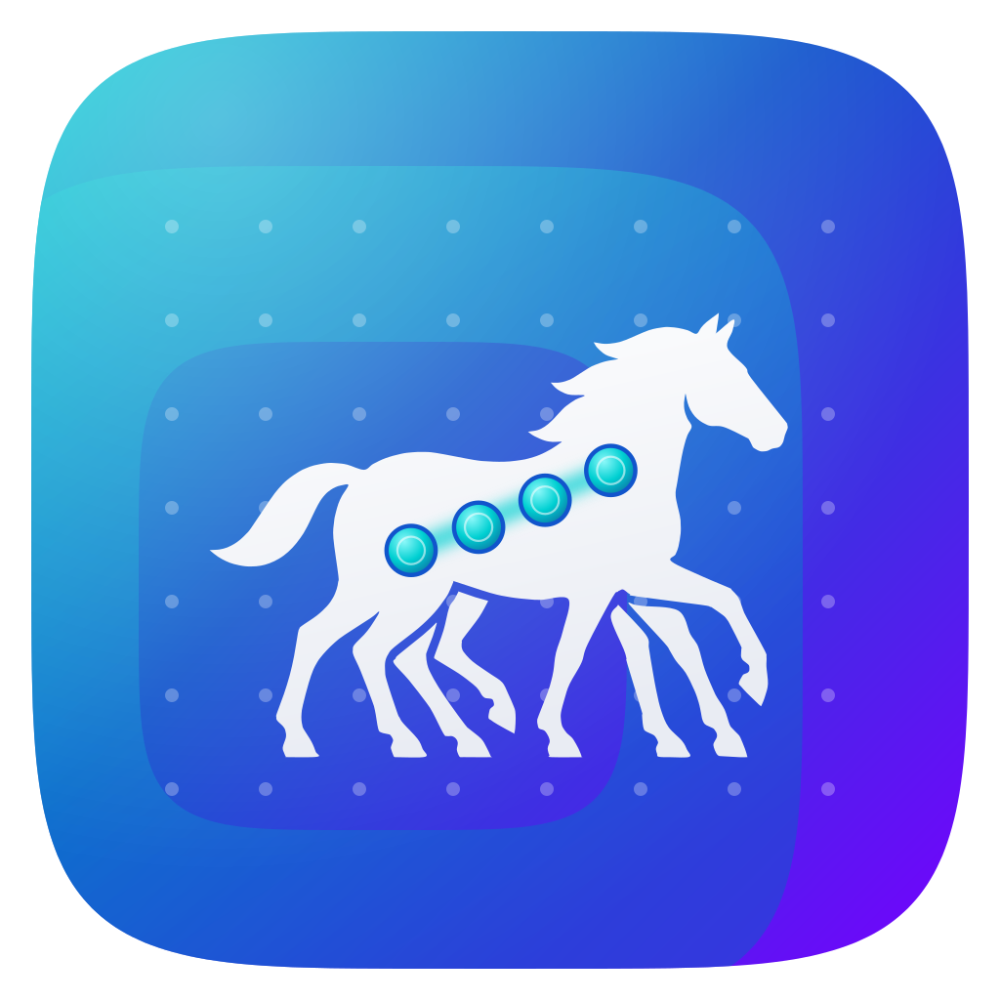
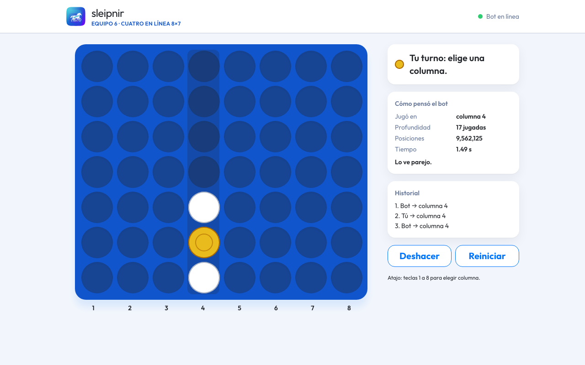
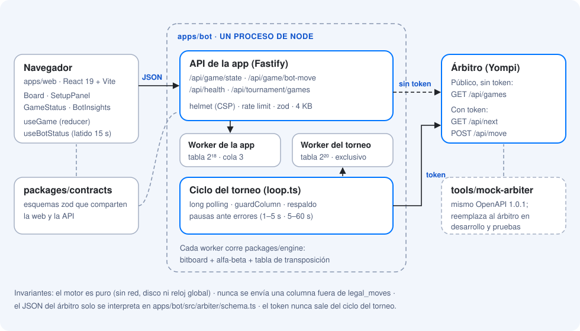
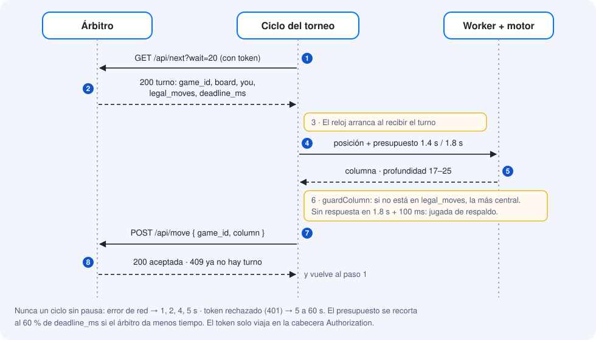
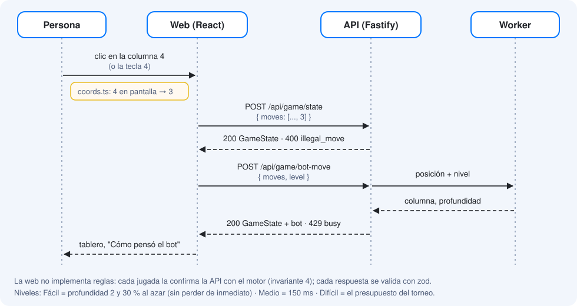
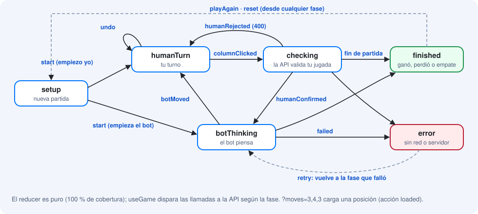
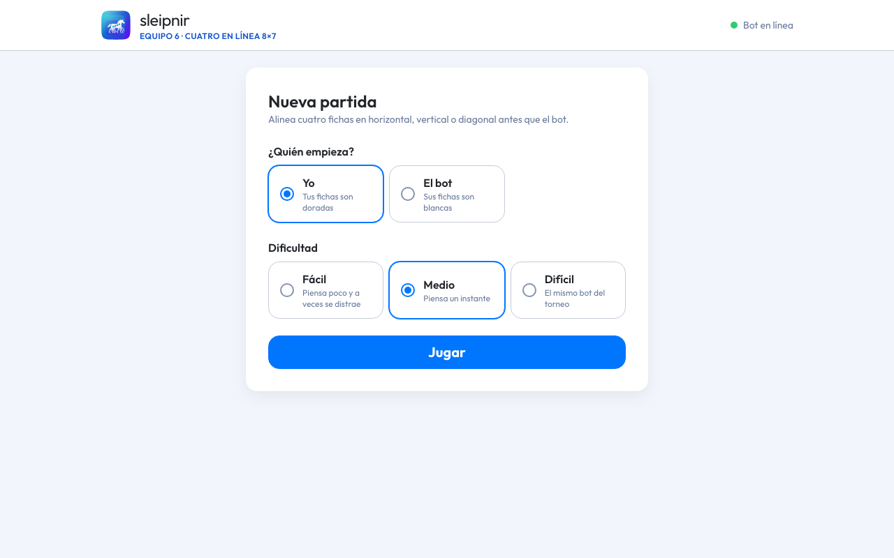
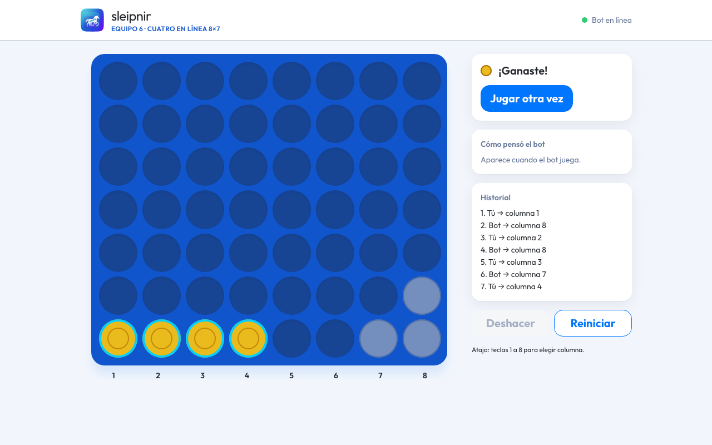
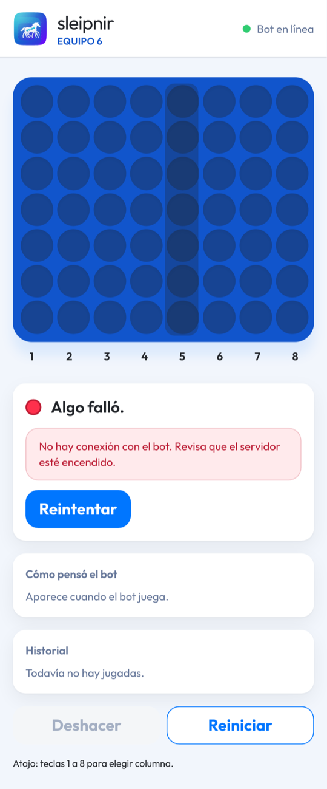

# Sleipnir — Cuatro en línea 8×7 (Equipo 6)

**Sleipnir**, el caballo de ocho patas de Odín: ocho columnas y cuatro en línea.

Bot que juega Cuatro en línea en un tablero de **8 columnas × 7 filas** y una app web para jugar contra
él. Challenge de IA de Yompi, Yalutec y Migo — jueves 5 de noviembre de 2026.

> **Estado: pasos B1–B6, B9 + S1, F1–F4, F6 (diseño) y Q3 (E2E).** Ya existen la estructura, las
> herramientas de calidad, las reglas, el árbitro simulado (OpenAPI 1.0.1), el cliente del torneo, la
> búsqueda alfa-beta en workers (profundidad 17–25 en 1.4 s), la API de la app con sus controles de
> seguridad, la **app web jugable** con el migo Design System y las pruebas de navegador con evidencias.
> Faltan la arena, los logs a archivo, el endurecimiento final, la repetición del torneo en la web y el
> manual.



**Contenido:** [Instalación](#instalación) · [Comandos](#comandos) · [Arquitectura](#arquitectura) ·
[Stack](#stack-tecnológico) · [Backend](#inventario-del-backend) · [Frontend](#inventario-del-frontend) ·
[Pruebas E2E](#pruebas-e2e-y-evidencias) · [Variables de entorno](#variables-de-entorno) ·
[Calidad](#calidad-automática) · [Documentos](#documentos) · [Contactos](#equipo-y-contactos)

## Requisitos

- **Node.js 22.22 o superior** (desarrollado en 26). Con nvm: `nvm use` lee `.nvmrc`.
- npm 10 o superior y git.

## Instalación

```bash
npm ci
```

Instala las dependencias y activa los hooks de git (ver [Calidad automática](#calidad-automática)).

## Comandos

| Comando | Qué hace |
|---|---|
| `npm test` | **comando único de pruebas:** todas las pruebas + reporte de cobertura (en consola y en `coverage/index.html`) |
| `npm run test:watch` | pruebas en modo observador mientras programas |
| `npm run mock` | árbitro simulado en `http://127.0.0.1:8787` ([guía y partida con curl](tools/mock-arbiter/README.md)) |
| `npm run bot` | API de la app en `:8080`; el bot del torneo se inicia desde la web (**Mi equipo**) o, con `ARBITRO_ENABLED=true`, al arrancar; lee `.env` |
| `npm run bench` | velocidad de la búsqueda (nodos/s) y profundidad con el presupuesto del torneo |
| `npm run dev` | API (`:8080`) + app web con recarga en caliente (`http://localhost:5173`) |
| `npm run build` | build de la app web en `apps/web/dist`; `npm run bot` la sirve en `http://127.0.0.1:8080` |
| `npm run build:vercel` | build para Vercel en `.vercel/output`: la web como estáticos y la API de la app como función ([ver abajo](#app-web-en-vercel)) |
| `npm run test:e2e` | pruebas de navegador (Playwright + axe) en modo **automático**: sin ventana, rápidas |
| `npm run test:e2e:demo` | las mismas en modo **con pausas**: navegador visible y 1.5 s entre pasos para verlas |
| `npm run lint` | ESLint, sin avisos permitidos |
| `npm run format` · `npm run format:check` | Prettier: formatear o solo revisar |
| `npm run typecheck` | TypeScript estricto en todos los paquetes |
| `npm run audit` | vulnerabilidades altas o críticas en dependencias de producción |
| `npm run verify` | todo lo anterior junto, igual que el CI |

## Arquitectura

Un solo proceso de Node sirve la app web y su API y, en la máquina del torneo, corre además el ciclo
contra el árbitro. La búsqueda nunca corre en el hilo principal: la app y el torneo tienen cada uno su
worker, así una partida en el navegador no bloquea una jugada del torneo.



**Un turno del torneo.** El reloj arranca cuando llega el turno, no con la hora del árbitro. La columna
pasa por `guardColumn` antes de salir, y ante cualquier error hay una pausa.



**Una jugada en la app.** La web no conoce las reglas: cada jugada de la persona la valida la API y la
del bot la calcula un worker.



Los diagramas son SVG propios en [`docs/assets/diagramas/`](docs/assets/diagramas/) (sin Mermaid), con
los colores del migo Design System. El detalle del motor está en [`docs/TECNICO.md`](docs/TECNICO.md).

## Stack tecnológico

**Backend y motor**

| Capa | Tecnología | Versión |
|---|---|---|
| Lenguaje | TypeScript estricto (sin `any`); Node lo ejecuta directo, sin paso de compilación | 6.0.3 |
| Runtime | Node.js con `worker_threads` y `fetch` nativos | ≥ 22.22.1 |
| Framework HTTP | Fastify, con `@fastify/helmet`, `@fastify/rate-limit` y `@fastify/static` | 5.12.8 |
| Validación | zod: entorno, JSON del árbitro y contrato API ↔ web | 4.6.7 |
| Motor | propio, sin dependencias: bitboard de 64 bits, negamax alfa-beta, tabla de transposición | — |
| Base de datos | **ninguna**: la API no guarda estado (cada petición trae sus jugadas) y las partidas del torneo viven en el árbitro | — |
| Nube | **ninguna**: corre en la laptop del equipo el día del torneo; la app se abre en la red local | — |
| Monorepo | npm workspaces: `packages/*`, `apps/*`, `tools/*` | npm ≥ 10 |

**Frontend**

| Capa | Tecnología | Versión |
|---|---|---|
| UI | React | 19.3.1 |
| Build | Vite + `@vitejs/plugin-react` | 8.3.5 |
| Estilos | Tailwind CSS con los tokens del migo Design System ([`index.css`](apps/web/src/index.css)) | 4.3.4 |
| Componentes base | propios al estilo shadcn/ui: `class-variance-authority`, `clsx`, `tailwind-merge` (sin Radix) | — |
| Tipografía | Outfit (licencia OFL), servida por nuestro propio servidor | 5.3.0 |
| Gestión de estado | `useReducer` dentro del hook `useGame`; sin Redux, Zustand ni Context | — |
| Routing | ninguno: una sola pantalla que cambia según la fase; `?moves=` carga una posición | — |
| Cliente HTTP | `fetch` nativo con timeout de 10 s y cancelación; cada respuesta se valida con zod | — |

**Pruebas y calidad:** Vitest 5.1 con cobertura v8, fast-check 4.10 (pruebas de propiedades), Testing
Library + jsdom, Playwright 1.64 + axe 4.14, ESLint 10 + typescript-eslint, Prettier 3.9, husky,
lint-staged y commitlint.

## Inventario del backend

### Endpoints de la API de la app

Código en [`apps/bot/src/http/`](apps/bot/src/http/). Todas responden JSON con esquema estricto
([`packages/contracts`](packages/contracts/src/index.ts)), aceptan solo `application/json` y cuerpos de
hasta 4 KB.

| Método | Ruta | Qué hace | Código |
|---|---|---|---|
| `GET` | `/api/health` | latido: versión y estado del ciclo del torneo (`enabled`, `state`, `lastTurnAt`, `gamesPlayed`) | [app.ts:37](apps/bot/src/http/app.ts#L37) |
| `POST` | `/api/game/state` | recibe `{ moves }`, aplica las reglas y devuelve tablero, jugadas legales, estado, ganador y línea ganadora | [game-routes.ts:37](apps/bot/src/http/game-routes.ts#L37) |
| `POST` | `/api/game/bot-move` | recibe `{ moves, level }`; el bot juega y explica su jugada (columna, profundidad, nodos, ms, puntaje) | [game-routes.ts:48](apps/bot/src/http/game-routes.ts#L48) |
| `GET` | `/api/tournament/games` | partidas del torneo de nuestro equipo (`TEAM_ID`), leídas de las rutas públicas del árbitro **sin token** | [tournament-routes.ts:27](apps/bot/src/http/tournament-routes.ts#L27) |
| `GET` | `/api/tournament/games/:id` | una partida con sus jugadas; `id` validado con `^[A-Za-z0-9_-]{1,64}$` antes de armar la URL | [tournament-routes.ts:42](apps/bot/src/http/tournament-routes.ts#L42) |
| `GET` | `/*` | el build de la web (`WEB_DIR`), sin archivos ocultos | [app.ts:51](apps/bot/src/http/app.ts#L51) |

Las dos rutas de torneo ya están en la API; la pantalla que las usa (F7) está pendiente.

**Códigos de error** (`{ error, message }`, con el mensaje en español):

| HTTP | `error` | Cuándo |
|---|---|---|
| 400 | `validation` | el cuerpo no cumple el esquema, JSON mal formado o id de partida inválido |
| 400 | `illegal_move` | una jugada cae fuera del tablero, en una columna llena o después del final |
| 404 | `not_found` | ruta, archivo o partida que no existe (los 403 de archivos también se responden 404) |
| 413 · 415 | `validation` | cuerpo de más de 4 KB · `Content-Type` distinto de JSON |
| 429 | `rate_limited` | se pasó el límite por IP |
| 429 | `busy` | el worker de la app tiene la cola llena (3 pedidos) |
| 503 | `tournament_unavailable` | falta `ARBITRO_URL` o el árbitro no respondió |
| 500 | `internal` | error no previsto: queda en el log, sin detalles para el cliente |

### Servicios externos

| Servicio | URL base | Para qué |
|---|---|---|
| Árbitro del torneo (Yompi) | `ARBITRO_URL` = `https://{host}`; el subdominio se anuncia el jueves a las 8:00 | `GET /api/next` y `POST /api/move` con `Authorization: Bearer <token>`, solo desde la máquina A; `GET /api/games` y `/api/games/{game_id}`, públicas, para la repetición |

Contrato: [`spec/arbitro-openapi.json`](spec/arbitro-openapi.json), versión final 1.0.1 de los
organizadores. Todo su JSON se interpreta solo en
[`apps/bot/src/arbiter/schema.ts`](apps/bot/src/arbiter/schema.ts). Las llamadas no siguen
redirecciones.

### Árbitro simulado

`npm run mock` levanta [`tools/mock-arbiter`](tools/mock-arbiter/README.md), fiel al OpenAPI: cada
respuesta se valida contra el spec en las pruebas de contrato.

| Método | Ruta | Token | Qué hace |
|---|---|---|---|
| `GET` | `/api/next?wait=0..25` | sí | turno pendiente, con long polling |
| `POST` | `/api/move` | sí | envía la jugada: 400 pierde la partida, 409 (ya no hay turno) no penaliza |
| `POST` | `/api/practice` | sí | partida de práctica contra un bot de la casa |
| `GET` | `/api/me` | sí | datos del equipo, posición y turnos pendientes |
| `PUT` | `/api/me/submission` | sí | registra la entrega: URL del repo y commit final |
| `GET` | `/api/games` · `/api/games/{game_id}` | no | lista de partidas y registro de una |
| `GET` | `/api/standings` | no | tabla de posiciones |
| `GET` | `/api/state` · `/api/live` | no | snapshot del torneo y estado en vivo (Server-Sent Events) |
| `GET` | `/api/health` · `/api/openapi.json` | no | latido y el contrato |
| `POST` | `/_mock/games` | no | **solo del mock:** crea partidas entre equipos o contra bots de la casa |

### Reglas de negocio y límites

- **Juego:** tablero 8×7, `board[fila][columna]` con la fila 0 abajo. Gana quien alinea cuatro en
  horizontal, vertical o diagonal; empate con las 56 casillas llenas
  ([`rules.ts`](packages/engine/src/rules.ts), 100 % de cobertura).
- **Jugada segura:** nunca se envía una columna fuera de `legal_moves`
  ([`guard.ts`](apps/bot/src/arbiter/guard.ts)). Si el motor falla o no responde en 1.8 s + 100 ms, se
  usa la jugada de respaldo: ganar en 1, bloquear el cuatro del rival o la más central.
- **Tiempo:** 1.4 s blando y 1.8 s duro por jugada, recortados al 60 % de `deadline_ms` si el árbitro da
  menos. El reloj arranca al recibir el turno.
- **Juego limpio:** ningún ciclo sin pausa. Error de red: 1, 2, 4 y 5 s. Token rechazado: de 5 a 60 s.
- **API de la app:** `moves` es una lista de hasta 56 enteros de 0 a 7 y `level` es `easy`, `medium` o
  `hard`. Límites por IP: 120 peticiones/min y 30 `bot-move`/min. CSP `default-src 'self'` y
  `frame-ancestors 'none'`.
- **Niveles:** Fácil = profundidad 2 y 30 % de jugadas al azar, solo entre las que no pierden de
  inmediato. Medio = 150 ms. Difícil = el mismo presupuesto del torneo.

Amenazas, controles y resultados del pentest interno: [`docs/SEGURIDAD.md`](docs/SEGURIDAD.md).

### Dependencias de producción

| Paquete | Versión | Dónde | Para qué |
|---|---|---|---|
| `fastify` | 5.12.8 | bot, mock | servidor HTTP |
| `@fastify/helmet` | 13.2.0 | bot | cabeceras de seguridad y CSP |
| `@fastify/rate-limit` | 11.2.1 | bot | límite de peticiones por IP |
| `@fastify/static` | 10.1.10 | bot | sirve el build de la web; ≥ 10.1.10 porque las anteriores traían un `glob` vulnerable |
| `zod` | 4.6.7 | bot, contracts, web | valida entorno, JSON del árbitro y contrato API ↔ web |
| `ajv` + `ajv-formats` | 8.20.0 · 3.0.1 | mock | valida las respuestas del mock contra el OpenAPI |

`packages/engine` no tiene dependencias. Cada dependencia nueva se justifica en su commit y pasa por
`npm audit`.

## Inventario del frontend

Código en [`apps/web/src/`](apps/web/src/).

### Componentes

| Componente | Responsabilidad | Props |
|---|---|---|
| [`App`](apps/web/src/App.tsx) | arma las pantallas "Nueva partida" y "Partida" | `client: ApiClient`, `initialMoves?: string \| null` |
| [`Header`](apps/web/src/components/Header.tsx) | logo, nombre del equipo y estado del bot | `status: BotStatus` |
| [`SetupPanel`](apps/web/src/components/SetupPanel.tsx) | quién empieza y nivel (Fácil, Medio, Difícil) | `humanFirst`, `level`, `onChange`, `onStart` |
| [`Board`](apps/web/src/components/Board.tsx) | tablero 8×7: un botón con `aria-label` por columna, ficha que cae, línea ganadora resaltada | `game`, `human`, `interactive`, `pendingColumn?`, `onPlay` |
| [`GameStatus`](apps/web/src/components/GameStatus.tsx) | de quién es el turno, resultado, avisos, "Reintentar" y "Jugar otra vez" | `phase`, `game`, `human`, `notice`, `onRetry`, `onPlayAgain` |
| [`BotInsights`](apps/web/src/components/BotInsights.tsx) | "Cómo pensó el bot": columna, profundidad, posiciones, tiempo y veredicto | `insight: BotInsight \| null` |
| [`MoveHistory`](apps/web/src/components/MoveHistory.tsx) | historial de jugadas en columnas 1–8 | `moves`, `human` |
| [`Button`](apps/web/src/ui/button.tsx), [`Card`](apps/web/src/ui/card.tsx) | base al estilo shadcn/ui; `Button` con variantes `primary` y `secondary` | las nativas de `button` y `section`, más `variant` |

### Hooks y servicios

| Nombre | Métodos o valor | API que consume |
|---|---|---|
| [`useGame(client, initialMoves)`](apps/web/src/game/useGame.ts) | `{ state, game, send }`; llama a la API según la fase y escucha las teclas 1–8 | `POST /api/game/state`, `POST /api/game/bot-move` |
| [`useBotStatus(client)`](apps/web/src/game/useBotStatus.ts) | `BotStatus`: en línea, sin conexión y estado del torneo; consulta cada 15 s | `GET /api/health` |
| [`createApiClient()`](apps/web/src/api/client.ts) | `state(moves)`, `botMove(moves, level)`, `health()` → `ApiResult`: `ok`, o `rejected` / `failed` / `aborted` con mensaje en español | las tres anteriores |
| [`createFakeClient()`](apps/web/src/api/fake-client.ts) | el mismo contrato en memoria, con el motor real; solo lo importan las pruebas | ninguna |
| [`ui/coords.ts`](apps/web/src/ui/coords.ts) | única conversión entre columnas 0–7 (código) y 1–8 (pantalla) | ninguna |

### Rutas

| Ruta | Pantalla | Protección |
|---|---|---|
| `/` | "Nueva partida" y, al empezar, "Partida" (sin router: cambia según la fase) | ninguna: es una app pública en la red local; la API tiene límites por IP, CSP y esquemas estrictos |
| `/?moves=3,4,3` | carga una posición (columnas 0–7, hasta 56) para demos y pruebas | la API valida cada jugada |

### Gestión de estado

No hay Redux, Zustand ni Context. Todo el estado de la partida vive en un `useReducer` dentro de
`useGame`. El reducer ([`game/reducer.ts`](apps/web/src/game/reducer.ts)) es puro y tiene 100 % de
cobertura.

- **Estado:** `phase`, `humanFirst`, `level`, `history`, `pendingColumn`, `insight`, `notice` y
  `resumePhase`.
- **Acciones:** `configure`, `start`, `columnClicked`, `humanConfirmed`, `humanRejected`, `botMoved`,
  `failed`, `retry`, `undo`, `playAgain`, `reset`, `loaded` y `dismissNotice`.
- **Historial:** `history` guarda solo estados confirmados por la API, así que "Deshacer" es volver
  atrás en esa lista.



### Variables de entorno del frontend

**Ninguna.** La web no lee `import.meta.env` ni tiene un `environment.ts` por entorno. Siempre llama a su
propio origen:

- **Desarrollo:** Vite redirige `/api` a `http://127.0.0.1:8080` ([`vite.config.ts`](apps/web/vite.config.ts)).
- **Producción y demo:** el mismo servidor de la API sirve el build.

La conexión al árbitro del panel **Mi equipo** no es una variable de entorno: cada quien la escribe en la
web (ver abajo).

### Panel "Mi equipo"

La pestaña **Mi equipo** (`#equipo`) tiene un formulario con la **URL del árbitro**, el **team ID** y el
**token del equipo**. Con eso el navegador consulta el árbitro directamente
([`apps/web/src/arbiter/`](apps/web/src/arbiter/)):

- posición, puntos, turnos pendientes y entrega registrada (`GET /api/me`);
- crear una práctica contra `casa-basico` o `casa-aleatorio` (`POST /api/practice`);
- registrar la entrega (`PUT /api/me/submission`), con la misma validación del OpenAPI;
- las partidas del equipo (`GET /api/games`, filtradas por team ID);
- **el tablero de una partida en vivo** (`GET /api/games/{id}` cada 1.5 s): la que el equipo está jugando
  se abre sola, y cualquier partida de la lista se abre con un clic. Nuestro bot va con fichas blancas y
  el rival con doradas; al terminar, el tablero queda con el resultado y la lista se actualiza.

Dónde queda cada dato: la URL y el team ID se recuerdan en ese navegador (`localStorage`); el **token solo
en esa pestaña** (`sessionStorage`) y se borra al cerrarla o con **Olvidar token**. El token va únicamente
al árbitro: nunca a la API de la app, a un log ni al repo. El bot del torneo sigue leyendo su `.env`.

**Bot del torneo: iniciar y detener desde la web.** En la app de la laptop (`npm run bot`, en
`http://127.0.0.1:8080`) el panel tiene la tarjeta **Bot del torneo**, con los botones **Iniciar escucha** y
**Detener escucha**. Así no hace falta `ARBITRO_ENABLED=true` ni reiniciar el servidor:

1. `npm run bot` una vez (el servidor queda en espera, sin jugar).
2. En **Mi equipo**, guarda la URL del árbitro y el token, y da **Iniciar escucha**.
3. El bot de esta computadora pregunta por sus turnos y juega; la tarjeta muestra su estado.
4. **Detener escucha** lo para entre turnos.

El cómputo lo hace el servidor de la laptop; la página solo manda la orden. La URL y el token se pasan
al servidor al iniciar y viven solo en su memoria mientras escucha. Las rutas (`/api/control`) solo
aceptan peticiones de esa misma computadora y de esa misma página (403 si vienen de otra máquina de la
red o de otra web), y no existen en la app de Vercel, donde la tarjeta no aparece. Un solo bot a la vez
(invariante 7). Con `ARBITRO_ENABLED=true` en `.env`, el bot sigue arrancando solo como antes.

Para que funcione, el árbitro debe aceptar peticiones desde el navegador (CORS). El árbitro de prueba en
Vercel lo hace; el oficial se confirma el jueves. Si no lo permite, el panel muestra "No se pudo conectar"
y queda `curl` como respaldo.

### Dependencias de la web

| Paquete | Versión | Para qué |
|---|---|---|
| `react` · `react-dom` | 19.3.1 | interfaz |
| `@fontsource-variable/outfit` | 5.3.0 | tipografía del migo Design System, sin CDN |
| `class-variance-authority` · `clsx` · `tailwind-merge` | 0.7.1 · 2.1.1 · 3.7.0 | variantes y clases de los componentes base |
| `zod` + `@equipo6/contracts` | 4.6.7 | valida cada respuesta de la API |
| `vite` · `@vitejs/plugin-react` (desarrollo) | 8.3.5 · 6.2.1 | servidor de desarrollo y build |
| `tailwindcss` · `@tailwindcss/vite` (desarrollo) | 4.3.4 | estilos con los tokens del tema |
| `@testing-library/react` · `jsdom` (desarrollo) | 16.3.3 · 30.1.3 | pruebas de componentes |

## Pruebas E2E y evidencias

La primera vez: `npx playwright install chromium`. Luego, cualquiera de los dos modos:

```bash
npm run test:e2e                              # automático: escritorio y celular, ~20 s
npm run test:e2e:demo -- --project=escritorio # con pausas: para mirar cómo juega
E2E_DELAY_MS=3000 npm run test:e2e:demo       # pausas más largas
```

Nueve pruebas que corren en escritorio (1280×800) y en celular (Pixel 7), 18 en total, contra el
servidor real con el build de producción:

| Prueba | Qué comprueba |
|---|---|
| partida completa empezando yo | se juega hasta el resultado, con captura por turno |
| empieza el bot en Difícil | el bot abre, explica su jugada y se puede deshacer |
| ganar | la persona completa cuatro y se resalta la línea |
| empate | la última casilla llena el tablero sin cuatro en línea |
| columna llena | aviso y no cae ninguna ficha |
| mientras el bot piensa | "Espera, es turno del bot" |
| sin conexión | mensaje claro, "Reintentar" y la partida sigue |
| teclado | las teclas 1 a 8 juegan en esa columna |
| accesibilidad | axe sin violaciones serias ni críticas en nueva partida, partida en curso y resultado |

Además, cualquier `console.error` del navegador hace fallar la prueba. Cada corrida guarda su evidencia
en una carpeta propia, ordenada por día y hora:

```
evidencias/e2e/
├── INDICE.md                          ← todas las corridas: modo, resultado, commit
└── 2026-11-04/
    └── 22-26-17_automatico/
        ├── resumen.md                 ← qué pasó: pruebas, tiempos, capturas
        ├── capturas/<dispositivo>/<prueba>/NN-paso.png
        ├── reporte/index.html         ← reporte de Playwright
        └── resultados/                ← videos y trazas (siempre en modo con pausas)
```

`evidencias/` no va al repo (pesa decenas de MB por corrida): se comparte aparte. En el CI queda como
artefacto `evidencias-e2e`. Estas capturas son de la corrida del 4 de noviembre a las 22:26 (commit
`2352be9`, 18 de 18 en verde):

| Nueva partida | Ganaste: línea resaltada | Celular sin conexión |
|---|---|---|
|  |  |  |

## App web en Vercel

La app también se puede jugar en línea. Vercel no levanta el servidor de `npm run bot` (un proceso que
corre siempre), así que `npm run build:vercel` ([`scripts/vercel-build.ts`](scripts/vercel-build.ts)) arma
con la [Build Output API](https://vercel.com/docs/build-output-api):

- **estáticos:** el build de `apps/web`, con la misma CSP que la API;
- **una función** con la API de la app ([`apps/bot/src/vercel/handler.ts`](apps/bot/src/vercel/handler.ts)):
  usa el mismo `buildAppServer`, los mismos contratos y el mismo motor que el bot del torneo, con la
  búsqueda en el hilo de la función en lugar de un worker;
- **rutas:** `/api/*` va a la función; lo demás, a la web.

Para conectarlo: Vercel → Add New → Project → importar este repo, con *Root Directory* en la raíz. Lo demás
lo toma de [`vercel.json`](vercel.json). En Vercel **no** corre el ciclo del torneo (invariante 7) y el rate
limit vive en la memoria de cada instancia. Variables opcionales: `THINK_SOFT_MS`, `THINK_HARD_MS`,
`RATE_LIMIT_PER_MIN`, `BOT_MOVE_PER_MIN` y, para repetir partidas del torneo, `ARBITRO_URL` y `TEAM_ID`
(nunca `TEAM_TOKEN`).

## Variables de entorno

Copia `.env.example` a `.env` (git lo ignora y la guardia de secretos bloquea subirlo). La configuración
se valida al arrancar ([`config.ts`](apps/bot/src/config.ts)) y los errores nombran la variable sin
repetir su valor.

| Variable | Por defecto | Entorno | Uso |
|---|---|---|---|
| `ARBITRO_URL` | — | máquina A y demo | URL base del árbitro (se publica el jueves a las 8:00); `https` salvo el mock local |
| `TEAM_TOKEN` | — | **solo máquina A** | token del equipo; nunca en el repo, los logs ni las capturas |
| `ARBITRO_ENABLED` | `false` | máquina A, opcional | con `true`, el ciclo del torneo arranca solo al iniciar el servidor; si no, se inicia desde la web (**Mi equipo**) |
| `PORT` / `HOST` | `8080` / `127.0.0.1` | todas | API de la app; `HOST=0.0.0.0` solo en la máquina de demo |
| `THINK_SOFT_MS` / `THINK_HARD_MS` | `1400` / `1800` | todas | presupuesto de búsqueda por jugada |
| `LONGPOLL_WAIT_S` | `20` | máquina A | espera del long polling del árbitro |
| `LOG_DIR` | `./logs` | todas | carpeta de los logs JSONL; se usará en B8 (hoy los logs salen por la consola) |
| `TEAM_ID` | — | máquina A y demo | id público del equipo en el árbitro (p. ej. `eq6`): la app muestra solo nuestras partidas |
| `WEB_DIR` | `apps/web/dist` | todas | build del frontend que sirve el mismo servidor, si existe |
| `RATE_LIMIT_PER_MIN` / `BOT_MOVE_PER_MIN` | `120` / `30` | todas | límites por IP de la API de la app (las E2E los suben) |

**Solo para desarrollo y pruebas:**

| Variable | Por defecto | Uso |
|---|---|---|
| `MOCK_PORT` / `MOCK_HOST` | `8787` / `127.0.0.1` | dónde escucha el árbitro simulado |
| `MOCK_TEAMS` | `eq6` y `rival`, con tokens de prueba | equipos del mock: `id:token:Nombre;…` |
| `MOCK_SEED` | `6` | semilla de los bots de la casa |
| `MOCK_DEADLINE_MS` / `MOCK_ABSENCE_MS` | `3000` / `30000` | tiempo por jugada desde que se entrega el turno · tiempo sin pedir turno antes de perder por ausencia |
| `MOCK_PRACTICE_OPEN` / `MOCK_SUBMISSIONS_OPEN` | `true` | abre las prácticas y las entregas |
| `E2E_DELAY_MS` | `1500` en modo con pausas | pausa entre pasos de las E2E |
| `E2E_PORT` | `8181` | puerto del servidor que levantan las E2E |

**Jugar contra el bot en el navegador:**

```bash
npm run build && ARBITRO_ENABLED=false npm run bot
```

y abrir `http://127.0.0.1:8080`. En la máquina de demo, con `HOST=0.0.0.0`, también se abre desde un
celular en la misma red. Para cargar una posición: `?moves=3,4,3` (columnas 0–7, como la API).

**Probar el bot contra el mock** (dos terminales):

```bash
npm run mock
```

```bash
ARBITRO_URL=http://127.0.0.1:8787 TEAM_TOKEN=token-local-eq6 npm run bot
```

Luego se crean partidas de práctica con `curl` (ver [guía del mock](tools/mock-arbiter/README.md)). El
bot escribe un JSON por línea: una línea `jugada` por turno y `warn`/`error` si algo no cuadra.

## Estructura

```
packages/engine/        reglas + búsqueda; puro: sin red, sin fs, sin reloj ni azar globales
packages/contracts/     contrato API ↔ web (esquemas zod compartidos)
apps/bot/               cliente del árbitro + API de la app (Fastify), búsqueda en workers
apps/web/               app web: React + Vite + Tailwind (PLAN_FRONTEND.md)
tools/mock-arbiter/     árbitro simulado fiel al OpenAPI, con fallas inyectables
tools/secret-guard/     hook que bloquea .env y el valor real del token antes de commitear
e2e/                    pruebas de navegador (Playwright + axe) y su reporte de evidencias
spec/                   OpenAPI del árbitro (1.0.1, versión final de los organizadores)
docs/                   documentación; diagramas y capturas en docs/assets/
scripts/                utilidades: dev, E2E, benchmark
.github/                CI, Dependabot y plantilla de PR
```

Próximo, según el plan: `tools/arena`.

## Calidad automática

**En cada commit (hooks locales):**
- Prettier y ESLint sobre los archivos que cambiaste.
- El mensaje debe seguir Conventional Commits: `feat(engine): detecta victoria en diagonal ↘`.
- La guardia de secretos bloquea archivos `.env` y cualquier línea con el valor real de `TEAM_TOKEN`.

**Herramientas que hacen cumplir las reglas del repo:**
- ESLint impide que `packages/engine` use red, disco, procesos, `Math.random` o `Date.now`
  (invariante 1 de `AGENTS.md`).
- La cobertura de `packages/engine` debe ser ≥ 90 % o `npm test` falla (las bases piden 70 %), y la de
  `rules.ts`, 100 %.
- Pruebas de contrato: cada respuesta del árbitro simulado se valida contra `spec/arbitro-openapi.json`.

**En cada PR (GitHub Actions):** lint, formato, tipos, pruebas con cobertura, auditoría de dependencias
y resumen de cobertura en el job; luego E2E con Playwright + axe y sus evidencias como artefacto.

**SonarQube Cloud** se activa al conectar el repo. En GitHub: variables `SONAR_ORGANIZATION` y
`SONAR_PROJECT_KEY`, y secreto `SONAR_TOKEN`. Detalle en `PLAN_CALIDAD_SEGURIDAD.md` §1.2.

## Documentos

| Documento | Para qué |
|---|---|
| [`PLAN_BACKEND.md`](PLAN_BACKEND.md) | plan del bot: arquitectura, algoritmo, cliente del árbitro, API, pruebas, pasos, riesgos |
| [`PLAN_FRONTEND.md`](PLAN_FRONTEND.md) | plan de la app web: pantallas, componentes, estados, diseño, pasos, riesgos |
| [`PLAN_CALIDAD_SEGURIDAD.md`](PLAN_CALIDAD_SEGURIDAD.md) | git y flujo de trabajo, entornos, QA, seguridad y pentest interno |
| [`AGENTS.md`](AGENTS.md) | reglas que siguen los agentes de IA en este repo (`CLAUDE.md` lo importa) |
| [`.claude/agents/`](.claude/agents/) | subagentes de Claude Code para tareas que se repiten (ver abajo) |
| [`docs/SEGURIDAD.md`](docs/SEGURIDAD.md) | amenazas, controles y resultados del pentest interno |
| [`docs/TECNICO.md`](docs/TECNICO.md) | cómo funciona el motor, rendimiento, pruebas y desviaciones del plan |
| [`docs/BITACORA_IA.md`](docs/BITACORA_IA.md) | cómo usamos la IA: qué pedimos, qué falló, cómo lo verificamos |

## Subagentes de Claude Code

En `.claude/agents/` hay agentes para las tareas que se repiten. Claude Code los carga al abrir una
sesión en este repo, y se invocan por nombre ("usa el agente revisor-rubrica…"). Todos siguen
`AGENTS.md`.

| Agente | Para qué | Cuándo |
|---|---|---|
| `revisor-rubrica` | revisa el repo contra la rúbrica: qué falta, qué está exagerado (solo lee) | antes de cada entrega y a las 9:15 del jueves |
| `coach-exposicion` | preguntas y respuestas simples para que cualquiera explique el proyecto; modo examen | la noche anterior y antes de exponer |
| `documentador` | README, TECNICO, MANUAL, SEGURIDAD y bitácora con cifras verificadas | al cerrar cada paso |
| `empaquetador-equipo` | zip con todas las ramas, verificado en un clon limpio, y texto para el grupo | cada vez que haya avance para compartir |
| `qa-pruebas` | pruebas desde el plan antes del código; comprueba que cada control falla cuando debe | al empezar un paso o ante una prueba inestable |
| `auditor-seguridad` | pentest, OWASP, búsqueda del token y revisión de dependencias nuevas | al tocar la API o agregar dependencias |
| `verificador-navegador` | juega en el navegador, revisa consola y celular, y saca capturas para el manual | después de cambios en la web y para el manual |
| `contrato-arbitro` | compara un OpenAPI nuevo, deja que las pruebas de contrato muestren el cambio y adapta mock y lector | cuando llegue un OpenAPI nuevo |
| `operador-torneo` | checklist del jueves y vigilancia de la liga sin mostrar nunca el token | jueves desde las 7:30 |

## Equipo y contactos

**Sleipnir** (Equipo 6):

| Nombre | Rol |
|---|---|
| Luis Eduardo Godoy Morales | Fullstack Developer |
| Henry David Juárez Alvarado | Support |
| Pedro Alexander Lancerio Alvarado | Fullstack Developer |
| Daniel Alberto Mendez Díaz | Fullstack Developer |

Roles en el challenge y responsables por paso: `PLAN_BACKEND.md` §0.
