# Manual de usuario

Cómo jugar Cuatro en línea contra **Sleipnir**, el bot del Equipo 6. No hace falta saber programar.

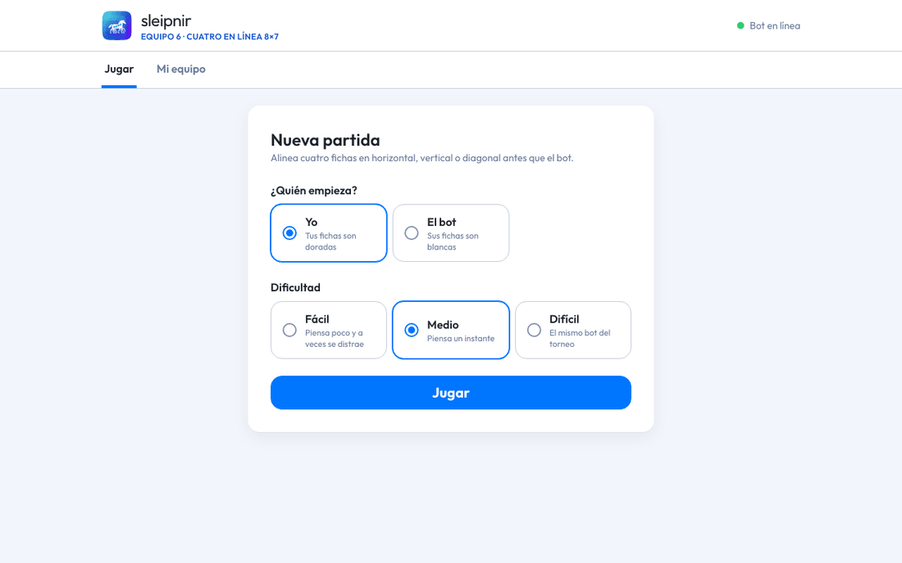

**Contenido:** [Abrir la app](#1-abrir-la-app) · [Reglas](#2-las-reglas-en-30-segundos) ·
[Empezar](#3-empezar-una-partida) · [Tu turno](#4-tu-turno) ·
[El bot piensa](#5-mientras-el-bot-piensa) · [Cómo pensó el bot](#6-cómo-pensó-el-bot) ·
[Deshacer](#7-deshacer-reiniciar-e-historial) · [Avisos](#8-avisos) ·
[Fin de la partida](#9-fin-de-la-partida) · [Celular](#10-en-el-celular) ·
[Mi equipo](#11-pestaña-mi-equipo-solo-para-el-equipo) · [Preguntas](#12-preguntas-frecuentes) ·
[Preparar la computadora](#para-quien-prepara-la-computadora)

## 1. Abrir la app

Abre en el navegador (Chrome, Edge, Safari o Firefox) la dirección que te dé el equipo:

- en la misma computadora donde corre el bot: `http://127.0.0.1:8080`;
- desde otro dispositivo de la misma red, por ejemplo un celular en el Wi-Fi de la demo:
  `http://<dirección-de-la-computadora>:8080` (algo como `http://192.168.1.20:8080`).

Arriba a la derecha está el estado del bot:

- **Bot en línea**, con un punto verde: todo listo para jugar.
- **Sin conexión con el bot**: el servidor está apagado o se cayó la red. Avisa al equipo.

La app tiene dos pestañas: **Jugar**, que es la que explica este manual, y **Mi equipo**, que solo usa
el equipo ([sección 11](#11-pestaña-mi-equipo-solo-para-el-equipo)).

## 2. Las reglas en 30 segundos

- El tablero tiene **8 columnas y 7 filas**.
- Por turnos, cada quien elige una columna y su ficha **cae hasta el espacio libre más bajo**.
- Gana quien alinea **cuatro fichas seguidas**: en horizontal, en vertical o en diagonal.
- Si el tablero se llena y nadie alineó cuatro, es **empate**.
- Tus fichas son **doradas, con un anillo**; las del bot son **blancas**.

## 3. Empezar una partida

En **Nueva partida**:

1. En **¿Quién empieza?**, elige **Yo** o **El bot**.
2. En **Dificultad**, elige el nivel:

   | Nivel | Qué dice la app | Qué hace el bot |
   |---|---|---|
   | **Fácil** | «Piensa poco y a veces se distrae» | mira 2 jugadas adelante y 3 de cada 10 veces juega al azar, aunque nunca una jugada que pierda de inmediato |
   | **Medio** | «Piensa un instante» | piensa unos 0.15 segundos |
   | **Difícil** | «El mismo bot del torneo» | piensa hasta 1.4 segundos y mira entre 17 y 25 jugadas adelante |

3. Pulsa **Jugar**.

## 4. Tu turno

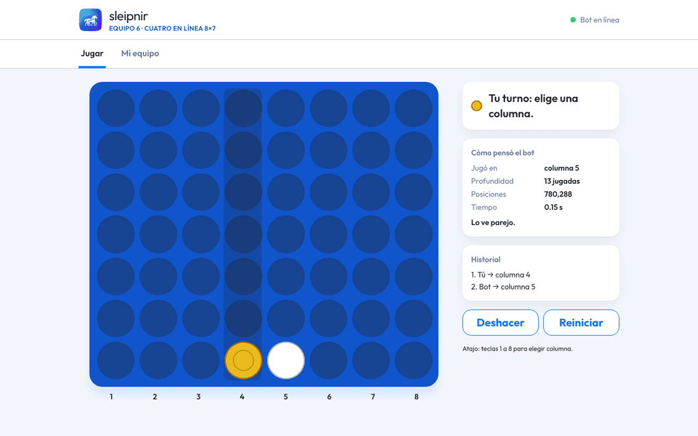

Cuando el recuadro dice **Tu turno: elige una columna.**, tienes dos formas de jugar:

- haz clic (o toca) en cualquier parte de la columna;
- o usa el teclado: las **teclas 1 a 8** juegan en esa columna. La 1 es la de la izquierda.

Las columnas están numeradas del 1 al 8 debajo del tablero. Al jugar, el recuadro dice **Colocando tu
ficha…** mientras el servidor confirma la jugada; es casi instantáneo. Después cae tu ficha y le toca
al bot.

Si usas un lector de pantalla, cada columna se anuncia con su número y los espacios que le quedan.

## 5. Mientras el bot piensa

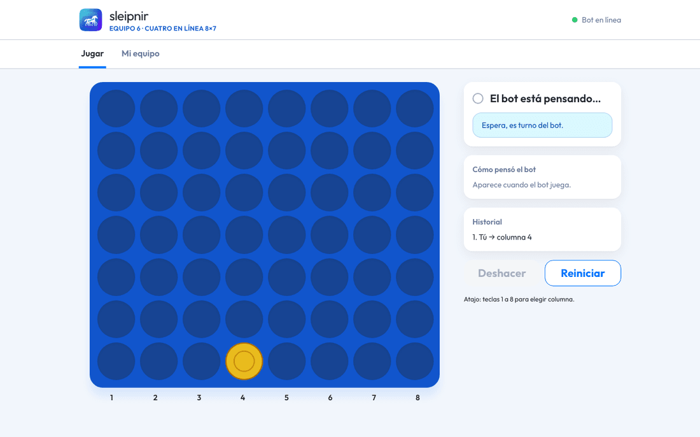

El recuadro dice **El bot está pensando…**. En Difícil puede tardar hasta un segundo y medio. Si haces
clic en el tablero mientras tanto, la app te recuerda **Espera, es turno del bot.** y no cae ninguna
ficha.

## 6. «Cómo pensó el bot»

Después de cada jugada del bot, la tarjeta **Cómo pensó el bot** explica su decisión:

| Dato | Qué significa |
|---|---|
| **Jugó en** | la columna que eligió |
| **Profundidad** | cuántas jugadas hacia adelante imaginó, suyas y tuyas |
| **Posiciones** | cuántos tableros distintos revisó |
| **Tiempo** | cuánto pensó |

Abajo dice qué opina de la partida: «Lo ve parejo.», «Cree que va ganando.», «Cree que vas ganando
tú.», «Ya vio cómo ganar.» o «Sabe que va a perder.».

Por ejemplo, en Difícil, al abrir la partida: columna 5, 17 jugadas de profundidad, más de 9 millones
de posiciones, 1.34 segundos.

## 7. Deshacer, reiniciar e historial

- **Deshacer** retira tu última jugada y la respuesta del bot, para que vuelvas a elegir. Se activa
  cuando ya hiciste al menos una jugada.
- **Reiniciar** abandona la partida y vuelve a **Nueva partida**.
- **Historial** muestra todas las jugadas en orden, por ejemplo «1. Tú → columna 4».

## 8. Avisos

**Columna llena.** Si eliges una columna que ya no tiene espacio, aparece **Esa columna está llena.
Elige otra.** y no cae ninguna ficha.

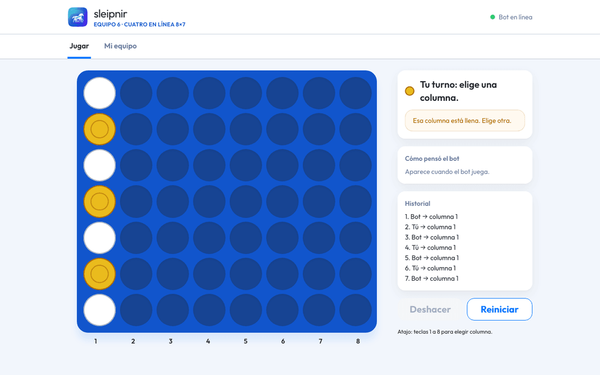

**Sin conexión.** Si se cae la red o el servidor, aparece **Algo falló.** con el mensaje **No hay
conexión con el bot. Revisa que el servidor esté encendido.** La partida no se pierde: cuando vuelva
la conexión, pulsa **Reintentar** y sigue donde ibas.

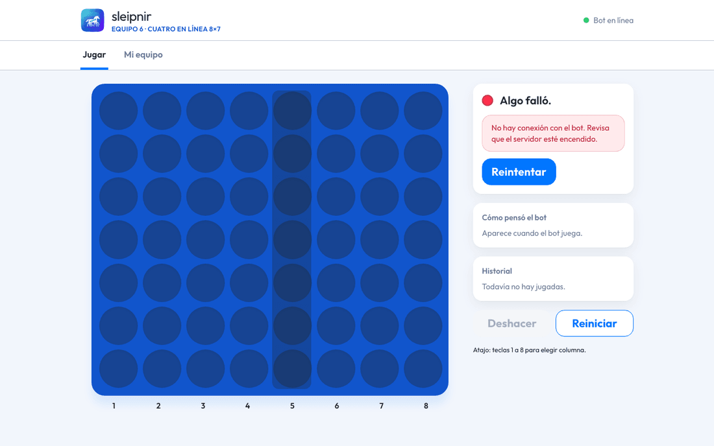

## 9. Fin de la partida

| ¡Ganaste! | Ganó el bot. | Empate |
|---|---|---|
| 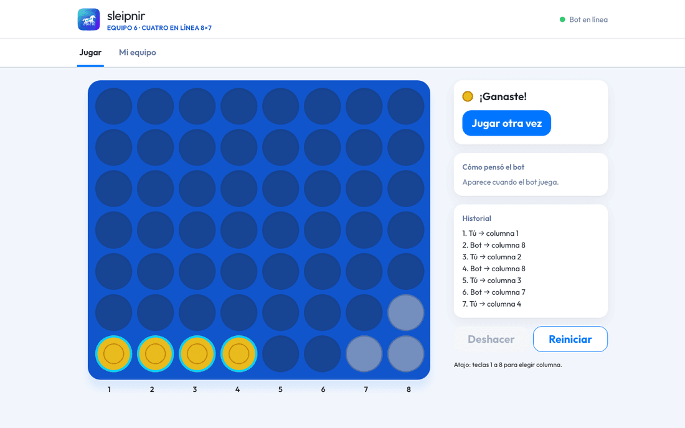 | 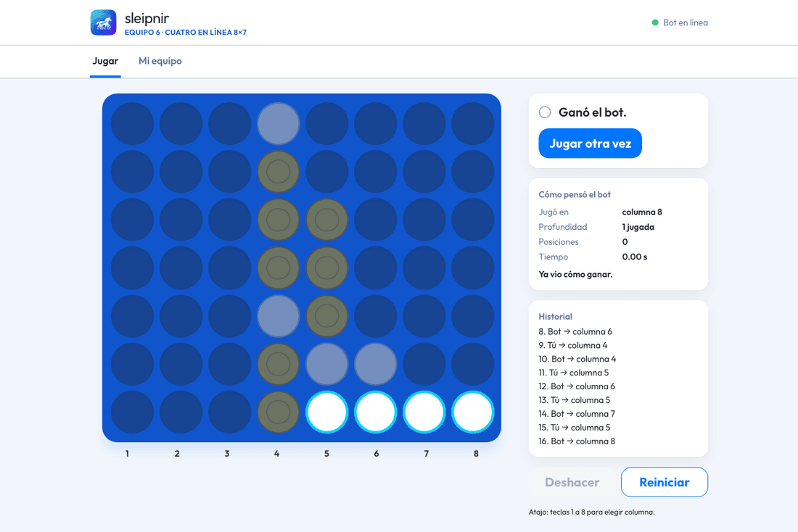 | 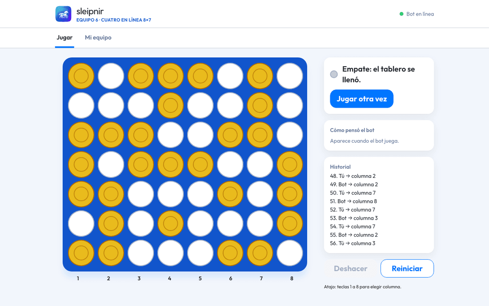 |
| tu línea de cuatro queda resaltada | también se resalta la línea del bot | **Empate: el tablero se llenó.** |

Pulsa **Jugar otra vez** para volver a **Nueva partida**.

## 10. En el celular

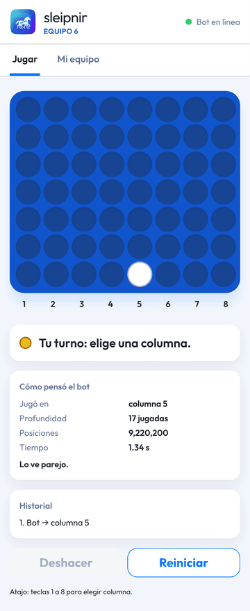

La app se adapta a la pantalla del celular: toca la columna donde quieres jugar. El celular tiene que
estar en la misma red que la computadora del bot.

## 11. Pestaña «Mi equipo» (solo para el equipo)

Esta pestaña es para quien opera el bot en el torneo, en la laptop del equipo. Pide la URL del árbitro,
el team ID y el token, que solo tiene el equipo. **Para jugar no la necesitas.**

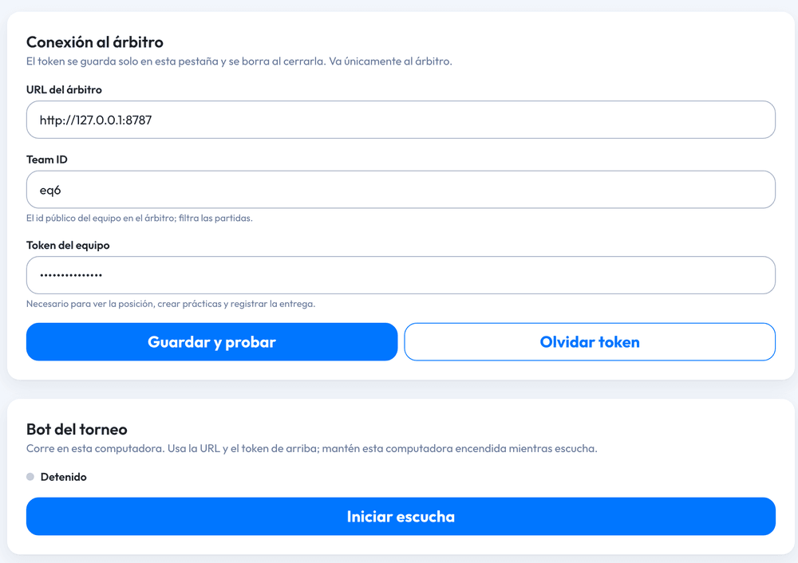

1. Escribe la **URL del árbitro**, el **team ID** y el **token del equipo**, y pulsa **Guardar y
   probar**.
2. En **Bot del torneo**, pulsa **Iniciar escucha**: el bot empieza a pedir sus turnos al árbitro y a
   jugar. **Detener escucha** lo para. Mientras escucha, la laptop tiene que quedarse encendida.
3. Más abajo puedes **crear una práctica** contra un bot de la casa, ver la posición del equipo y
   **registrar la entrega** (URL del repositorio y hash del commit).

La partida que está jugando el bot se abre sola en un tablero en vivo, que se actualiza cada segundo y
medio. Cualquier otra partida de la lista **Partidas del equipo** se abre con su botón **Ver tablero**:

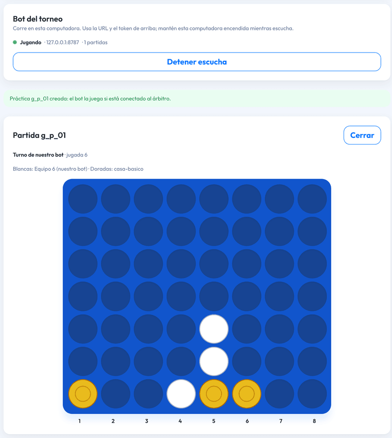

_Captura de una prueba con nuestro árbitro simulado: nuestro bot juega con blancas._

El token se guarda solo en esa pestaña del navegador y se borra al cerrarla o con **Olvidar token**.
No lo escribas en la computadora de la demo ni lo muestres en pantalla. El paso a paso del día del
torneo está en el [README](../README.md#día-del-torneo).

## 12. Preguntas frecuentes

**¿El bot hace trampa o ve mis jugadas antes?** No. Solo juega cuando le toca, y cada jugada, tuya y
suya, la valida el servidor con las mismas reglas.

**¿El bot aprende de mí?** No. No se entrena con partidas: en cada turno calcula con un algoritmo de
búsqueda y solo guarda cálculos para pensar más rápido.

**¿Por qué en Difícil tarda más?** Porque usa el mismo tiempo que en el torneo para mirar entre 17 y 25
jugadas adelante.

**¿Se guardan mis partidas?** No. Si recargas la página, empiezas una partida nueva.

**¿Puedo jugar desde el celular?** Sí, si está en la misma red que la computadora del bot
([sección 10](#10-en-el-celular)).

**Dice «Sin conexión con el bot».** El servidor está apagado o se cayó la red. Avisa al equipo y,
cuando vuelva, pulsa **Reintentar**.

## Para quien prepara la computadora

Con Node 22.22 o superior:

```bash
npm ci          # solo la primera vez
npm run build   # compila la app web
npm run bot     # sirve la app en http://127.0.0.1:8080
```

Para que otros dispositivos de la red local abran la app, **solo en la computadora de la demo**, se
arranca con `HOST=0.0.0.0 npm run bot` y se comparte `http://<dirección-de-la-computadora>:8080`. La
laptop del torneo se queda en `127.0.0.1`. Más detalles en el [README](../README.md).
